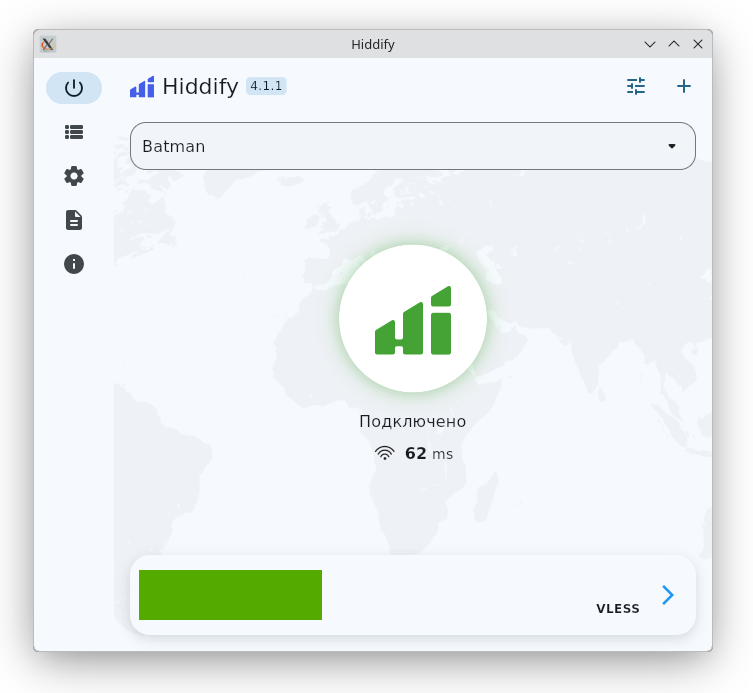

# Hiddify-RPM (Mageia / Fedora)
RPM packages of [Hiddify Client](https://github.com/hiddify/hiddify-app), repackaged from the original Debian packages.

**Dependencies:** libGLESv2.so.2()(64bit), libayatana-appindicator3.so.1()(64bit)
 
**User Data and Configuration:**
+ configurations: ~/.local/share/app.hiddify.com
+ autostart mode: ~/.config/autostart/hiddify.desktop 
+ icons: ~/.local/share/icons/hicolor/{128x128,256x256}/apps/hiddify.png

**12334** - Local mixed port (SOCKS5 / HTTP)

**Modes:** Proxy, System Proxy, VPN, Router (network-wide), protection / unblock via WARP / Psiphon.



## Motivation for building a package
No RPM package is available, and the AppImage fails to start with the following error:
```
./Hiddify-Linux-x64-AppImage.AppImage
./hiddify: usr/lib/libcrypto.so.3: version `OPENSSL_3.2.0' not found (required by /lib64/libcryptsetup.so.12)
```
To automatically fix an AppImage, use [Hiddify.AppImage-Fix.tar.gz](https://github.com/AKotov-dev/Hiddify-RPM/raw/refs/heads/main/Hiddify.AppImage-Fix.tar.gz) and specify the Hiddify version number in the `fix.sh` script.
